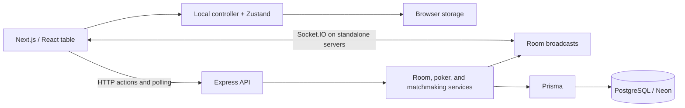

<a id="readme-top"></a>

<div align="center">
  <a href="https://poker.yanyihan.top/">
    
  </a>

# PokerChip Ledger

**One table for home-game scoring and online Texas Hold’em.**

Track chips at a physical table, share a scoring room, or play a server-dealt game with friends.

**English** · [简体中文](README.zh-CN.md)

[Open app](https://poker.yanyihan.top/) · [Documentation](docs/README.md) · [Report a bug](https://github.com/YanYihann/poker-chip-tracker/issues/new?labels=bug) · [Request a feature](https://github.com/YanYihann/poker-chip-tracker/issues/new?labels=enhancement)

[](https://nextjs.org/)
[](https://react.dev/)
[](https://www.typescriptlang.org/)
[](LICENSE)


[Watch the full-resolution video](docs/assets/pokerchip-ledger-demo.mp4)

</div>

<details>
<summary>Table of contents</summary>

- [About the project](#about-the-project)
- [Features](#features)
- [Screenshots](#screenshots)
- [Getting started](#getting-started)
- [Usage](#usage)
- [Configuration](#configuration)
- [Architecture](#architecture)
- [Development and deployment](#development-and-deployment)
- [Contributing](#contributing)
- [License](#license)
- [Acknowledgments](#acknowledgments)

</details>

## About the project

PokerChip Ledger brings seating, betting actions, pots, hand results, and session reports into a shared table interface. Record a physical game on one device, synchronize scorekeeping across devices, or play online with server-side dealing and hand evaluation.

| Experience | Account | Cards and settlement | State lives in |
| --- | --- | --- | --- |
| Local scoring | Not required | Physical cards; operator selects winners for each pot | Browser storage |
| Synced scoring | Required | Physical cards; host confirms winners | Server and PostgreSQL |
| Online play | Required | Server deals cards and evaluates winners | Server and PostgreSQL |

Local scoring works without the API after its page has loaded. Online rooms require a running backend and database. The interface supports English and Simplified Chinese; new visits default to English and remember the selected language in the browser.

The app tracks virtual chips and game results; it does not process payments or real-money transactions.

## Features

- **A complete table flow:** seats, starting stacks, blinds, fold, check, call, bet, raise, and all-in.
- **Private rooms:** create a room, share its four-digit code, and start play as the host.
- **Quick match:** choose 2–8 players and a Beginner, Advanced, or Expert tier; enter preparation, choose seats, and ready up before dealing.
- **Server-side poker rules:** private hole cards, street progression, automatic hand evaluation, side pots, split pots, refunds, and odd-chip distribution.
- **Shared continuation:** after an online hand, seated players with chips agree to the next hand; participants can also confirm ending the session.
- **Session records:** hand breakdowns, final chip balances, net transfers, profile totals, and archived room history.
- **Adaptive synchronization:** Socket.IO on a persistent server; visible-room HTTP polling on Vercel, targeting 250 ms during active hands and 750 ms in preparation or settlement.
- **A responsive table:** desktop and mobile layouts, animated chip movement, sound controls, local snapshots, and language switching.

## Screenshots

<table>
  <tr><th>Room preparation</th><th>Online table</th><th>Hand settlement</th></tr>
  <tr>
    <td></td>
    <td></td>
    <td></td>
  </tr>
</table>

<details>
<summary>More screens: room creation, joining, and profile</summary>

<table>
  <tr><th>Create a room</th><th>Join a room</th><th>Profile</th></tr>
  <tr>
    <td></td>
    <td></td>
    <td></td>
  </tr>
</table>

</details>

## Getting started

### Prerequisites

- Node.js 20 or newer and npm 10 or newer.
- PostgreSQL locally, or a Neon database, for accounts and online rooms.

### Install and run local scoring

```bash
git clone https://github.com/YanYihann/poker-chip-tracker.git
cd poker-chip-tracker
npm ci
npm run dev
```

Open [http://localhost:3000/local](http://localhost:3000/local). This mode needs no account or database. The root npm workspace installs both frontend and server dependencies.

### Enable online rooms

From the repository root, copy the environment examples:

```bash
cp .env.example .env.local
cp server/.env.example server/.env
```

PowerShell also accepts these commands, or you can use `Copy-Item`. Set `DATABASE_URL` and `DATABASE_URL_DIRECT` in `server/.env` to your development database, then initialize it:

```bash
npm run prisma:generate --workspace server
npm run prisma:migrate:deploy --workspace server
```

Keep the frontend running and start the API in a second terminal:

```bash
npm run dev --workspace server
```

The API defaults to [http://localhost:4001](http://localhost:4001). `GET /health` returns `{ "status": "ok", "database": "up" }` when the database is reachable. See the [local development guide](docs/local-dev.md) for details.

## Usage

| Goal | Steps |
| --- | --- |
| Score a physical game on one device | Open **Local game**, set up players and seats, record actions, and select eligible winners at settlement. Resume saved progress in the same browser. |
| Share scoring across devices | Sign in, create a **Synced scoring** room, share the code, and let the host start and confirm winners. |
| Play with friends online | Create an **Online play** room, share the code, and start as host. Each player acts from their own device; the server deals and settles. |
| Find a table | Choose **Quick match**, table size, and tier. Pick a seat and select **Ready**. Play begins when the table is full and everyone is ready. |
| Review a session | End the room session and open its report from history to inspect hands, final balances, and transfers. |

Quick-match tiers use virtual chips:

| Tier | Starting stack | Small / big blind |
| --- | ---: | ---: |
| Beginner | 10,000 | 100 / 200 |
| Advanced | 50,000 | 500 / 1,000 |
| Expert | 100,000 | 1,000 / 2,000 |

## Configuration

Frontend settings belong in `.env.local`; backend settings belong in `server/.env` for standalone development.

| Variable | Purpose |
| --- | --- |
| `NEXT_PUBLIC_API_BASE_URL` | Optional backend origin. Local development defaults to the current local hostname on the API port; deployed hosts use the same origin. |
| `NEXT_PUBLIC_API_PORT` | Local API port fallback; defaults to `4001`. |
| `NEXT_PUBLIC_API_TRANSPORT` | Set to `polling` for Vercel; leave unset for a standalone Socket.IO server. |
| `DATABASE_URL` | PostgreSQL runtime connection; use a pooled URL for Neon. |
| `DATABASE_URL_DIRECT` | Direct PostgreSQL connection for Prisma migrations. |
| `PORT` | Standalone API port; defaults to `4001`. |
| `CLIENT_ORIGIN` | Comma-separated allowed frontend origins. |
| `SESSION_COOKIE_NAME` | Authentication cookie name; defaults to `poker_chip_session`. |
| `SESSION_TTL_DAYS` | Session lifetime; defaults to `30` days. |

On Vercel, the app also accepts the Neon integration variables `NEON_DATABASE_URL` and `NEON_DATABASE_URL_UNPOOLED`, which take precedence over the corresponding database settings. Keep actual credentials in local environment files or hosting settings.

## Architecture



Shared table components connect to mode-specific adapters. The browser owns standalone local state; the server validates online actions, protects private cards, and commits room state and settlement. Vercel serves Next.js and the Express API together through `/api/*`; a persistent Node.js deployment can also provide Socket.IO.

| Path | Contents |
| --- | --- |
| `src/app/` | Pages, layouts, manifest, and app icons |
| `src/components/` | Shared table, player, action, settlement, and language UI |
| `src/features/` | Table adapters, room transport, authentication, and matchmaking |
| `src/store/` | Local session, hand, betting, and archive state |
| `server/src/` | Express routes, domain services, authentication, and Socket.IO |
| `server/prisma/` | Database schema and versioned migrations |
| `tests/` | Rule, synchronization, layout, and integration checks |
| `public/` | Brand assets and install icons |
| `docs/` | Guides, specifications, screenshots, demo, and portfolio notes |
| `scripts/` | Icon generation, encoding maintenance, and deployment migrations |

## Development and deployment

Run these checks from the repository root:

```bash
npm run lint
npm run typecheck
npm test
npm run lint --workspace server
npm run typecheck --workspace server
npm run build --workspace server
```

`npm test` runs the `*.test.ts` suite. Database integration suites are separate: they require an explicitly configured disposable local database ending in `_test` via `ROOM_TEST_DATABASE_URL`; without it, they skip. See the [integration instructions](docs/deployment-vercel.md#room-lifecycle-integration-checks).

`npm run build` generates Prisma, compiles the server, and builds Next.js. **In a production Vercel environment, it also applies pending database migrations.** Local builds skip that migration step. Review the target database before a production build or push to a connected deployment branch.

Deployment guides:

- [Vercel + Neon](docs/deployment-vercel.md): combined frontend/API with HTTP polling.
- [Railway + Neon](docs/deployment-railway-neon.md): persistent backend with Socket.IO.
- [Deployment checklist](docs/deployment-checklist.md).

## Contributing

Open an [issue](https://github.com/YanYihann/poker-chip-tracker/issues) to discuss a bug or feature, or fork the repository and submit a focused pull request. Describe the behavior change and relevant validation. Preserve local scoring when changing online flows, and keep the English and Chinese READMEs aligned.

## License

Distributed under the [MIT License](LICENSE). Copyright © 2026 [YanYihann](https://github.com/YanYihann).

## Acknowledgments

README layout adapted from [Best-README-Template](https://github.com/othneildrew/Best-README-Template), with presentation ideas from [awesome-readme](https://github.com/matiassingers/awesome-readme): a clear introduction, useful badges, visual demos, and a practical quick start.

<p align="right"><a href="#readme-top">Back to top</a></p>
