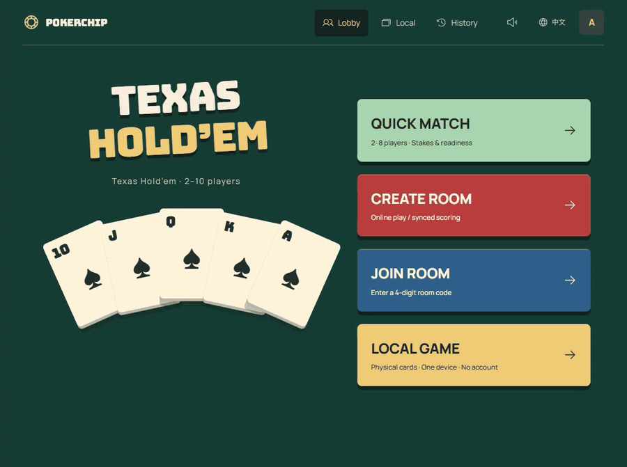
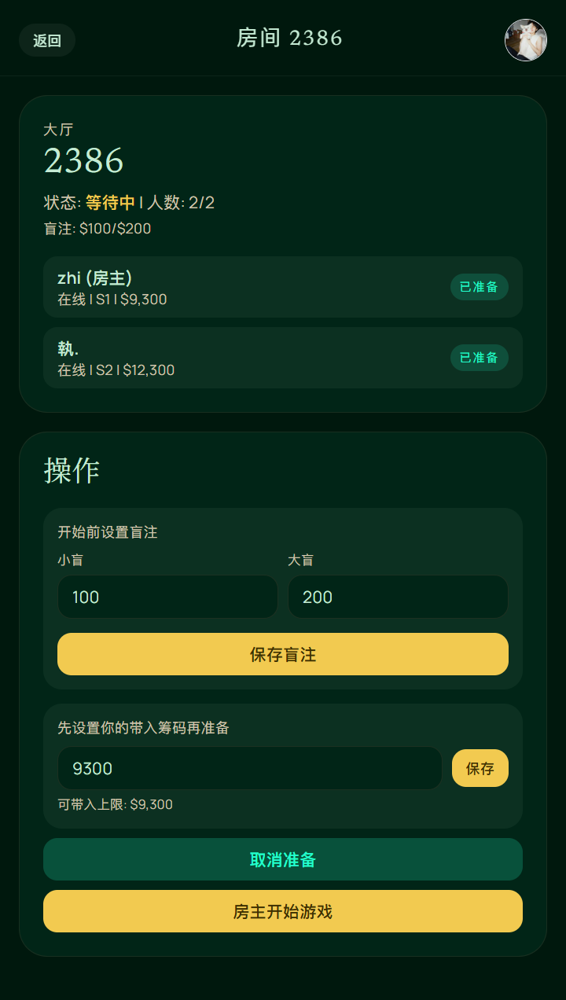
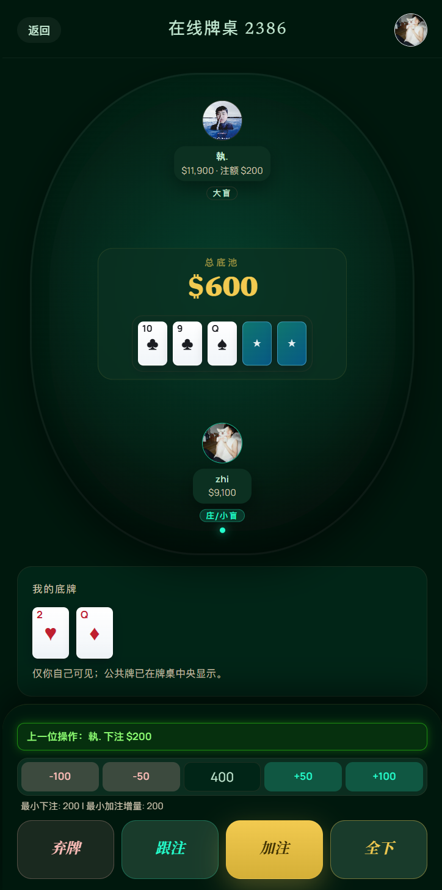
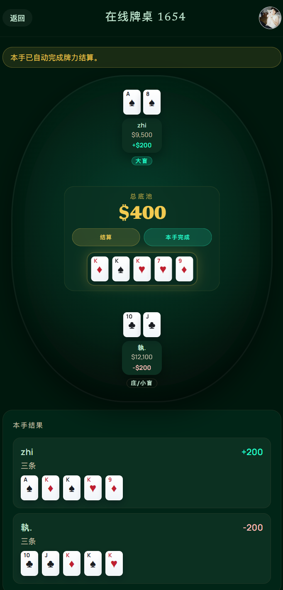
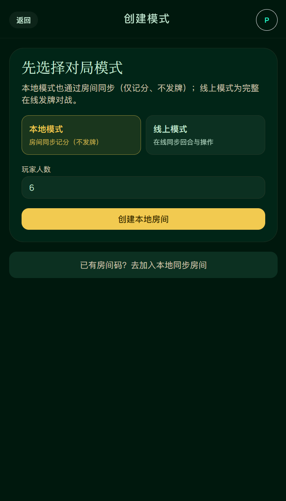
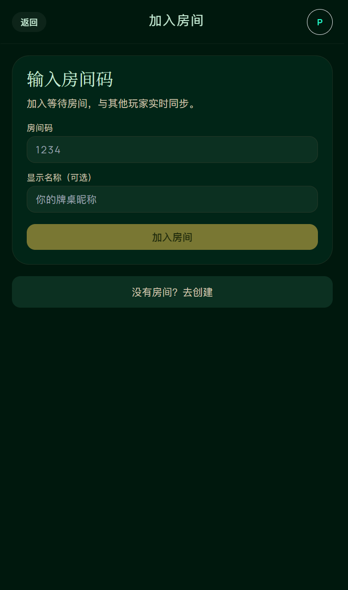
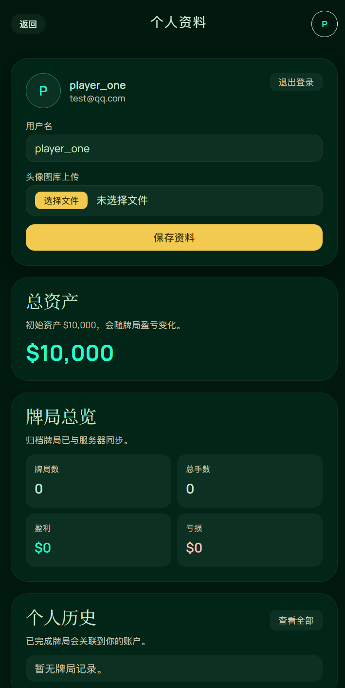
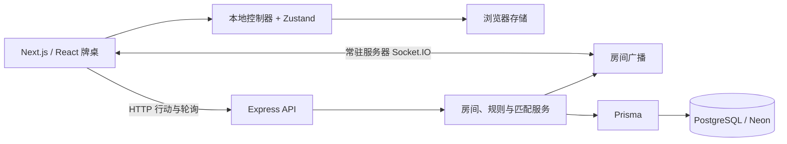

<a id="readme-top"></a>

<div align="center">
  <a href="https://poker.yanyihan.top/">
    
  </a>

# PokerChip Ledger

**一张牌桌，连接线下计分与线上德州扑克。**

单设备记录实体牌局，多设备同步计分，或与朋友进行服务端发牌的线上对战。

[English](README.md) · **简体中文**

[打开应用](https://poker.yanyihan.top/) · [项目文档](docs/README.md) · [报告问题](https://github.com/YanYihann/poker-chip-tracker/issues/new?labels=bug) · [提出建议](https://github.com/YanYihann/poker-chip-tracker/issues/new?labels=enhancement)

[](https://nextjs.org/)
[](https://react.dev/)
[](https://www.typescriptlang.org/)
[](LICENSE)



[观看清晰版视频](docs/assets/pokerchip-ledger-demo.mp4)

</div>

<details>
<summary>目录</summary>

- [项目介绍](#项目介绍)
- [主要功能](#主要功能)
- [界面预览](#界面预览)
- [快速开始](#快速开始)
- [使用方式](#使用方式)
- [环境配置](#环境配置)
- [项目架构](#项目架构)
- [开发与部署](#开发与部署)
- [参与贡献](#参与贡献)
- [许可证](#许可证)
- [致谢](#致谢)

</details>

## 项目介绍

PokerChip Ledger 将座位、下注行动、底池、单手结果和整场报告整合在同一套牌桌界面中。你可以用一台设备记录实体牌局，也可以跨设备同步计分，或通过服务端发牌和牌力判定直接线上对战。

| 使用方式 | 是否需要账号 | 扑克牌与结算 | 数据保存位置 |
| --- | --- | --- | --- |
| 本地计分 | 不需要 | 实体牌；操作员逐池选择赢家 | 浏览器存储 |
| 同步计分 | 需要 | 实体牌；房主确认赢家 | 服务端与 PostgreSQL |
| 线上对战 | 需要 | 服务端发牌并自动判定赢家 | 服务端与 PostgreSQL |

本地计分页面加载完成后，无需连接 API 即可使用。联机房间需要可用的后端与数据库。界面支持英文与简体中文，新访问默认英文，语言选择会保存在当前浏览器中。

应用记录虚拟筹码和牌局结果，不处理支付或真实货币交易。

## 主要功能

- **完整牌桌流程：** 座位、起始筹码、盲注，以及弃牌、过牌、跟注、下注、加注和全下。
- **私人房间：** 创建房间、分享四位房间码，由房主开始游戏。
- **快速匹配：** 选择 2–8 人及新手、高手或专家场；进入准备桌、选择座位并确认准备后再发牌。
- **服务端规则：** 私有底牌、阶段推进、自动牌力判定、边池、平分底池、未跟注退款与余数筹码分配。
- **共同决定继续：** 线上每手结束后，仍有筹码的入座玩家同意下一手；参与者也可以确认结束整场。
- **整场记录：** 单手明细、最终筹码、净转移、个人统计与已归档房间历史。
- **自适应同步：** 常驻服务器使用 Socket.IO；Vercel 对可见房间使用 HTTP 轮询，手牌进行中目标间隔 250 ms，准备或结算阶段为 750 ms。
- **响应式牌桌：** 适配桌面与手机，提供筹码动画、声音控制、本地快照和语言切换。

## 界面预览

<table>
  <tr><th>房间准备</th><th>线上牌桌</th><th>牌力结算</th></tr>
  <tr>
    <td></td>
    <td></td>
    <td></td>
  </tr>
</table>

<details>
<summary>更多界面：创建房间、加入房间与个人资料</summary>

<table>
  <tr><th>创建房间</th><th>加入房间</th><th>个人资料</th></tr>
  <tr>
    <td></td>
    <td></td>
    <td></td>
  </tr>
</table>

</details>

## 快速开始

### 环境要求

- Node.js 20 或更高版本，npm 10 或更高版本。
- 账号与联机房间需要本地 PostgreSQL 或 Neon 数据库。

### 安装并运行本地计分

```bash
git clone https://github.com/YanYihann/poker-chip-tracker.git
cd poker-chip-tracker
npm ci
npm run dev
```

打开 [http://localhost:3000/local](http://localhost:3000/local)，即可使用无需账号和数据库的本地计分。根目录的 npm workspace 会一并安装前后端依赖。

### 启用联机房间

在项目根目录复制环境变量示例：

```bash
cp .env.example .env.local
cp server/.env.example server/.env
```

PowerShell 也支持以上命令，或使用 `Copy-Item`。将 `server/.env` 中的 `DATABASE_URL` 和 `DATABASE_URL_DIRECT` 指向开发数据库，然后初始化：

```bash
npm run prisma:generate --workspace server
npm run prisma:migrate:deploy --workspace server
```

保持前端运行，在第二个终端启动 API：

```bash
npm run dev --workspace server
```

API 默认地址为 [http://localhost:4001](http://localhost:4001)。数据库可用时，`GET /health` 返回 `{ "status": "ok", "database": "up" }`。详细步骤见[本地开发指南](docs/local-dev.md)。

## 使用方式

| 目标 | 操作步骤 |
| --- | --- |
| 单设备记录实体牌局 | 打开 **Local game**，设置玩家和座位，记录行动并在结算时选择有资格的赢家；在同一浏览器恢复已保存的进度。 |
| 多设备同步计分 | 登录后创建 **Synced scoring** 房间，分享房间码，由房主开始并确认赢家。 |
| 与朋友线上对战 | 创建 **Online play** 房间并分享房间码，由房主开局。玩家在各自设备操作，服务端负责发牌和结算。 |
| 随机匹配 | 选择 **Quick match**、人数和场次，选座后点击 **Ready**；满员且全员准备后自动开局。 |
| 查看整场结果 | 结束房间后，从历史记录打开报告，查看每手明细、最终余额与转移结果。 |

匹配场次均使用虚拟筹码：

| 场次 | 起始筹码 | 小盲 / 大盲 |
| --- | ---: | ---: |
| 新手场 | 10,000 | 100 / 200 |
| 高手场 | 50,000 | 500 / 1,000 |
| 专家场 | 100,000 | 1,000 / 2,000 |

## 环境配置

前端设置位于 `.env.local`；独立运行后端时，后端设置位于 `server/.env`。

| 变量 | 用途 |
| --- | --- |
| `NEXT_PUBLIC_API_BASE_URL` | 可选的后端地址。本地默认使用当前本地主机名和 API 端口，部署后默认同源。 |
| `NEXT_PUBLIC_API_PORT` | 本地 API 备用端口，默认 `4001`。 |
| `NEXT_PUBLIC_API_TRANSPORT` | Vercel 设置为 `polling`；常驻 Socket.IO 服务器保持未设置。 |
| `DATABASE_URL` | PostgreSQL 运行连接；Neon 推荐使用连接池地址。 |
| `DATABASE_URL_DIRECT` | Prisma 数据库迁移使用的直连地址。 |
| `PORT` | 独立 API 服务端口，默认 `4001`。 |
| `CLIENT_ORIGIN` | 允许访问的前端来源，多个地址以逗号分隔。 |
| `SESSION_COOKIE_NAME` | 登录 Cookie 名，默认 `poker_chip_session`。 |
| `SESSION_TTL_DAYS` | 登录会话有效期，默认 `30` 天。 |

Vercel 上也支持 Neon 集成提供的 `NEON_DATABASE_URL` 和 `NEON_DATABASE_URL_UNPOOLED`，它们优先于对应的数据库变量。真实凭据应保存在本地环境文件或托管平台设置中。

## 项目架构



共享牌桌组件通过不同模式的适配器连接数据。本地单设备状态由浏览器维护；联机行动校验、私有底牌保护、房间状态提交与结算由服务端负责。Vercel 将 Next.js 与 Express API 部署在一起，通过 `/api/*` 提供接口；常驻 Node.js 服务还可以提供 Socket.IO。

| 路径 | 内容 |
| --- | --- |
| `src/app/` | 页面、布局、应用清单与图标 |
| `src/components/` | 共享牌桌、玩家、行动、结算与语言组件 |
| `src/features/` | 牌桌适配器、房间传输、认证与匹配 |
| `src/store/` | 本地整场、单手、下注与归档状态 |
| `server/src/` | Express 路由、领域服务、认证与 Socket.IO |
| `server/prisma/` | 数据库结构与版本化迁移 |
| `tests/` | 规则、同步、布局与集成检查 |
| `public/` | 品牌素材与安装图标 |
| `docs/` | 指南、规格、截图、演示与作品集资料 |
| `scripts/` | 图标生成、编码维护与部署迁移 |

## 开发与部署

在项目根目录执行：

```bash
npm run lint
npm run typecheck
npm test
npm run lint --workspace server
npm run typecheck --workspace server
npm run build --workspace server
```

`npm test` 运行 `*.test.ts` 测试。数据库集成测试单独运行，需要通过 `ROOM_TEST_DATABASE_URL` 显式指定名称以 `_test` 结尾的本地临时数据库；未配置时会跳过。详见[集成测试说明](docs/deployment-vercel.md#room-lifecycle-integration-checks)。

`npm run build` 会生成 Prisma 客户端、编译后端并构建 Next.js。**在 Vercel 生产环境中，此命令还会执行待应用的数据库迁移。** 本地构建跳过迁移步骤。在生产构建或向已关联部署的分支推送前，应核对目标数据库。

部署指南：

- [Vercel + Neon](docs/deployment-vercel.md)：前后端同项目，使用 HTTP 轮询。
- [Railway + Neon](docs/deployment-railway-neon.md)：常驻后端，支持 Socket.IO。
- [部署检查清单](docs/deployment-checklist.md)。

## 参与贡献

欢迎通过 [Issue](https://github.com/YanYihann/poker-chip-tracker/issues) 讨论问题或功能，或 Fork 后提交范围明确的 Pull Request。请说明行为变化和相关验证结果；修改联机功能时保留本地计分能力，并同步维护中英文 README。

## 许可证

本项目采用 [MIT License](LICENSE)。Copyright © 2026 [YanYihann](https://github.com/YanYihann)。

## 致谢

README 结构参考 [Best-README-Template](https://github.com/othneildrew/Best-README-Template)，并借鉴 [awesome-readme](https://github.com/matiassingers/awesome-readme) 收录案例中的清晰介绍、实用徽章、可视化演示和快速上手方式。

<p align="right"><a href="#readme-top">返回顶部</a></p>
